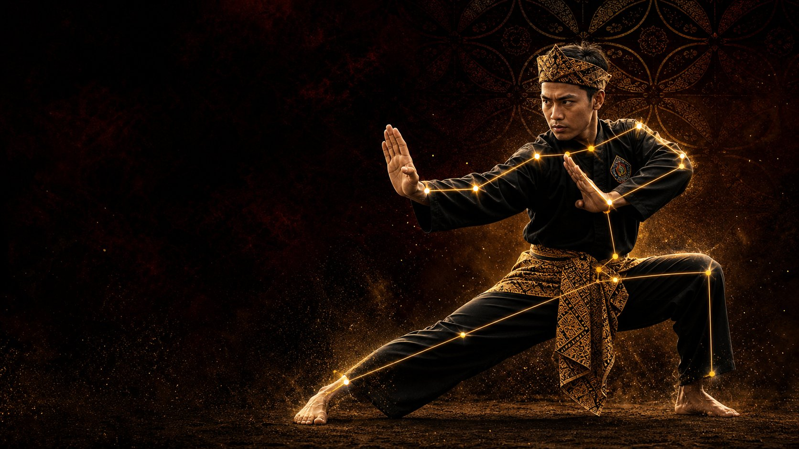
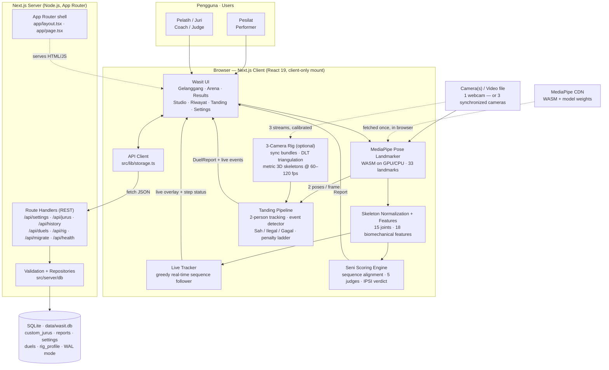
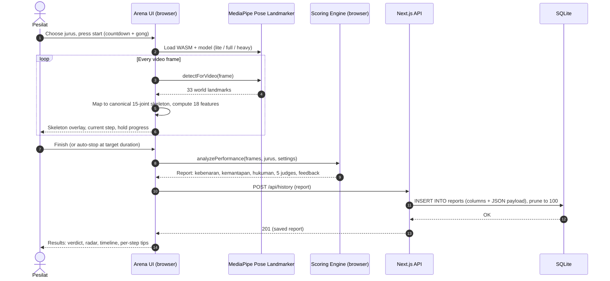
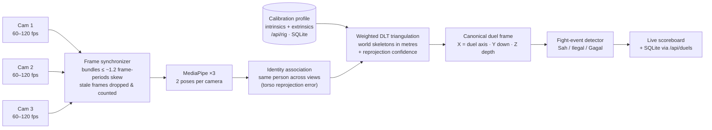
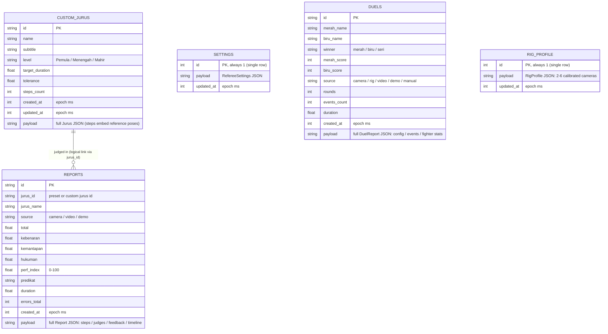

# Wasit Virtual Pencak Silat — AI Referee




**Wasit Virtual Pencak Silat** is an AI referee (*wasit*) for Pencak Silat. For **Seni Tunggal**: perform a *jurus* in front of your webcam — or upload a video — and receive an IPSI-style verdict covering sequence correctness, artistry and timing, with per-movement feedback in Bahasa Indonesia and English. For **Tanding** (fighting): two fighters, *Sudut Merah* vs *Sudut Biru*, are tracked live while the AI counts successful **punches, kicks, takedowns and body locks**, and judges every attack **Sah** (valid), **Ilegal** (illegal) or **Gagal** (blocked/missed) — from a single webcam or a calibrated, synchronized **3-camera 3D rig at 60–120 fps**.

Pose estimation (MediaPipe Pose Landmarker) and scoring run **entirely in the browser** — video never leaves the device. Custom jurus, referee settings and the verdict history persist **server-side in SQLite**, served by Next.js Route Handlers.

> A training aid, not an official competition result.

## Features

- **Gelanggang (Home)** — 5 preset jurus from *Pemula* to *Mahir*, including a full 3-minute IPSI-timing simulation (180 s ± 5 s), plus your own custom jurus.
- **Arena** — judge a performance via **live camera**, **uploaded video**, or a **simulated demo** (Pendekar / Pesilat / Pemula). Real-time skeleton overlay, live step tracking (matched / missed / hold progress), countdown and gong.
- **Results (Verdict)** — IPSI score breakdown from a panel of 5 virtual judges, a 0–100 performance index with *predikat*, radar & timeline charts, per-step comparison against the reference pose, and coaching tips (*Kebenaran, Kemantapan, Irama, Waktu, Penghayatan, Tenaga, Stamina, Kamera*). Exportable as JSON.
- **Studio** — build custom jurus from the 22 reference poses (sikap, kuda-kuda, pukulan, tangkisan, tendangan, elakan) or **record a master's demonstration** and capture its key poses.
- **Riwayat (History)** — every saved verdict (up to 100), reopenable in full detail.
- **Settings** — strictness, mirror tolerance, match threshold, component weights, sound, pose-model size (Lite ≈ 5 MB / Full ≈ 9 MB / Heavy ≈ 29 MB) and auto-stop.
- **Tanding (Duel)** — Merah vs Biru fight analysis: per-fighter counters of successful punches (1 pt), kicks (2), takedowns (3) and body locks (4), plus blocked/missed and **illegal** attacks (head, neck, groin…) on a 5-step penalty ladder up to disqualification. Live scoreboard with round clock, an AI event detector, a referee scoring pad (mouse or keyboard), editable verdicts (AI proposes — the *wasit* can flip any event Sah ↔ Ilegal ↔ Gagal), momentum chart and full post-match analysis. Sources: **1 camera**, **3-camera 3D rig (60/120 fps)**, uploaded video, AI demo simulation, or pure manual referee scoring. Matches persist in SQLite like everything else.

## High-Level Architecture



**Key design decisions**

| Decision | Rationale |
| --- | --- |
| Pose estimation & scoring in the browser | Privacy (video never uploaded) and zero server-side inference cost; WASM + model weights are fetched from CDN on first use. |
| Whole UI mounted client-only (`ssr: false`) | The app is camera/canvas/Web-Audio first; server-rendering it adds hydration risk for no benefit. Next.js still provides routing shell, metadata, bundling and the API. |
| SQLite via `better-sqlite3` (server-only) | Single-file, zero-admin persistence that survives restarts; synchronous prepared statements keep Route Handlers simple. The driver is kept out of the client bundle with `serverExternalPackages` + `server-only`. |
| Columns + JSON `payload` | Searchable/sortable fields are real columns; the full domain object (a jurus embeds reference poses, a report embeds skeletons/judges/timelines) is stored losslessly as JSON. |
| View-switcher instead of page routes | Preserves the original single-screen referee flow (Gelanggang → Arena → Results) and its state handling exactly. |
| Duel detector consumes canonical 3D points | The fight-event detector reads `Pt3` skeletons in a duel-canonical frame, so the *same* rules run on a flat webcam feed (z = 0), an uploaded video, the choreographed simulator, or triangulated 3-camera input — sources differ, judging doesn't. |

## How a Performance Is Judged



### Scoring model (IPSI Seni Tunggal structure)

| Component | How it is computed |
| --- | --- |
| **Nilai Kebenaran** (correctness) | 100 − number of movement errors. Each recorded frame is converted to 18 rotation-invariant features (joint angles, stance, lean, wrist height…) and compared with the jurus's reference poses; a full-sequence alignment decides which steps were hit, missed or mirrored. |
| **Nilai Kemantapan** (artistry, 50–60) | Blends stability, balance, power, rhythm (*irama*), expression (*penghayatan*), stamina and flow measured over the whole performance. |
| **Hukuman** (time penalty) | Deviation of the actual duration from the target beyond the jurus tolerance, banded IPSI-style. |
| **5 virtual judges** | Each judge profile (strict technique, balanced, firmness, rhythm, expression) scores independently; the highest and lowest totals are dropped and the **mean of the middle 3** becomes the official verdict. |
| **Performance index (0–100)** | Weighted blend (default Correctness 50 % · Artistry 30 % · Timing 20 %, adjustable in Settings) mapped to a *predikat*. |

Reference data ships in code: **22 reference poses** (11 authored poses + mirrored variants, built with forward kinematics) and **5 preset jurus** (*Jurus Dasar I/II, Latihan Kuda-kuda, Rangkaian Seni Tunggal, Simulasi Tunggal 3 Menit*).

## Tanding — Duel Analysis (Sudut Merah vs Sudut Biru)

The **Tanding** menu scores a fight between two fighters. For each fighter it counts, per technique, how many attacks were **successful & valid**, how many **failed**, and how many were **illegal**:

| Technique | Points when *sah* | Counted outcomes |
| --- | --- | --- |
| **Pukulan** (hand attack) | 1 | sukses · ditangkis (blocked) · meleset (missed) · ilegal |
| **Tendangan** (kick / knee) | 2 | sukses · ditangkis · meleset · ilegal |
| **Jatuhan** (takedown / dropping) | 3 | sukses (opponent's body, knee-up, touches the mat) · tidak-jatuh · ilegal (e.g. hitting a downed opponent) |
| **Kuncian** (body lock) | 4 | sukses (lock established & held) · lepas (escaped) · ilegal (choke) |

A defence followed by an immediate valid counter earns the IPSI **+1 bonus** (within 1.5 s). **Legal targets** are the *togok* (body protector area): chest (*dada*), abdomen above the navel (*perut*), ribs (*rusuk*) and back (*punggung*). **Illegal**: head (*kepala*), neck (*leher*), below-navel/groin (*kemaluan*), direct knee attacks, spine attacks, chokes, striking a downed opponent. Legs are an intermediate, non-scoring target. Fouls climb a training penalty ladder — Teguran I −1, Teguran II −2, Peringatan I −5, Peringatan II −10, 5th foul = **diskualifikasi** — and are re-computed whenever the referee edits an event. Default format is 3 rounds × 2 minutes (editable).

**How events are detected.** Both fighters are pose-tracked every frame. The detector watches limb kinematics (chamber → strike → contact/retract), contact zones on the opponent's body, block geometry (defender's forearm intercepting the striking limb), clinch ownership for body locks (must be held to count; >5 s of grappling warns the referee to separate), and body-axis collapse for takedowns. Every AI decision carries a confidence score and is **referee-editable** — during the match or afterwards — because pose estimation cannot measure impact force; in *konfirmasi wasit* mode AI events wait for the referee's tap before they score. The referee can also score fully manually (pads or keyboard: `Q W E R` + `F` for Merah, `U I O P` + `J` for Biru).

### The 3-camera, 60–120 fps synchronized rig

A single camera is a flat projection: depth, and therefore true geometric precision, is not recoverable from one view. The mathematical minimum for metric 3D is **2 calibrated, synchronized cameras** (triangulation); in a clinch, a joint is often visible in only 2 of 3 views, which makes **3 cameras the practical minimum** for Tanding (4 = competition-grade surround). The rig pipeline is built around that target:



- **Calibration** is imported as JSON (ChArUco/OpenCV convention: per camera `fx, fy, cx, cy`, 3×3 world→camera rotation, translation, image size, optional sync offset; world = metres, Y-up, origin at mat centre). It is validated in the browser *and* again server-side, and stored in SQLite (`rig_profile`; see `/api/rig`). A downloadable template is in the Tanding setup screen.
- **Synchronization** is software-based (browser capture timestamps + per-camera offsets): at 120 fps the bundle window is ≈10 ms. Hardware-genlocked/global-shutter cameras are recommended for the tightest skew; the UI shows live skew and reprojection error so a bad rig is visible, not hidden.
- **Without a calibration** the rig still runs synchronized, but honestly: analysis falls back to the primary camera in 2D (badge shown) — depth is never claimed when it wasn't measured.
- Verified headlessly (`npm run test:rig`): noise-free triangulation error < 1 mm; ≈0.3 cm mean error with 1.2 px synthetic noise; 120 fps synchronizer max skew ≈5 ms; and the full world-3D → detector path reproduces the expected punch/kick/lock/takedown/foul counts.

Whichever source is used, the match ends with an analysis page: winner & round scores, the per-technique sukses/coba/ditangkis/gagal/**ilegal** table for both fighters, accuracy, lock-hold time, foul chronicle, momentum chart and coaching insights — all persisted to SQLite (`duels`, newest 100).

## Persistence — SQLite

All mutable data lives in one SQLite file (default `data/wasit.db`, WAL mode, created automatically on first run):



Notes:

- `reports.jurus_id` is a *logical* link (no foreign key): verdicts can belong to preset jurus, which live in code, and a verdict must stay readable even after its custom jurus is deleted.
- History keeps the newest **100** verdicts (the old localStorage version capped at 25 due to browser quotas). Demo performances are never saved.
- Duel reports follow the same pattern (`duels`, newest 100; demo fights are not saved). The camera-rig calibration is a single-row table (`rig_profile`). Schema **v3** added `rig_profile` and the `'rig'` duel source; older databases are migrated automatically on boot (the `duels` table is rebuilt, rows preserved) — verified by `scripts/smoke-duel.mjs`.
- **Upgrading from the old Vite version?** On first load the app detects the legacy `localStorage` keys (`wasit-silat:*:v1`) and imports them into SQLite via `POST /api/migrate`. The import is idempotent (existing ids are never overwritten) and non-destructive (the old keys are left in place as a backup).
- Reset everything with `npm run db:reset` (stop the server first).

## Tech Stack

| Layer | Technology |
| --- | --- |
| Framework | Next.js 15.5 (App Router) · React 19 · TypeScript (strict) |
| Styling | Tailwind CSS v4 (PostCSS) · Lucide icons |
| Pose estimation | MediaPipe Pose Landmarker (`@mediapipe/tasks-vision`, WASM + model from CDN, GPU with CPU fallback) |
| Persistence | SQLite via `better-sqlite3` (prepared statements, WAL) behind Next.js Route Handlers |
| Tooling | ESLint (eslint-config-next) · `tsc --noEmit` |

## Getting Started

**Prerequisites:** Node.js **22+** (required by `better-sqlite3` v13), npm, and a modern browser with camera access. A GPU is recommended for the *Heavy* pose model.

```bash
# 1. Install dependencies
npm install

# 2. Run the dev server (http://localhost:3000)
npm run dev

# — or run a production build —
npm run build
npm run start
```

The SQLite database is created automatically at `data/wasit.db` on first use. To place it elsewhere (e.g. a Docker volume), copy `.env.example` to `.env.local` and set `DATABASE_PATH`:

```bash
DATABASE_PATH=/var/lib/wasit/wasit.db npm run start
```

Camera access requires a secure context: `localhost` works out of the box; remote hosts need HTTPS.

## Scripts

| Command | Purpose |
| --- | --- |
| `npm run dev` | Next.js dev server with HMR |
| `npm run build` | Production build (typecheck + lint included) |
| `npm run start` | Serve the production build |
| `npm run typecheck` | `tsc --noEmit` |
| `npm run lint` | ESLint (Next core-web-vitals + TypeScript) |
| `npm run db:reset` | Delete the SQLite database (fresh start on next launch) |
| `node scripts/smoke-test.mjs` | End-to-end API smoke test (Seni) against a running server (`BASE_URL` to override) |
| `npm run test:duel` | Headless tests: duel rules, penalty ladder, AI event detector on a choreographed simulator |
| `npm run test:rig` | Headless tests: calibration, triangulation accuracy, 120 fps sync, 3D→detector end-to-end |
| `node scripts/smoke-duel.mjs` | API smoke test for `/api/duels` + `/api/rig` against a running server (`BASE` to override) |

## Project Structure

```text
.
├── public/hero.jpg                 # landing hero image
├── data/                           # SQLite database (wasit.db, gitignored, auto-created)
├── scripts/
│   ├── reset-db.mjs                # npm run db:reset
│   ├── smoke-test.mjs              # Seni API end-to-end smoke test
│   ├── smoke-duel.mjs              # Tanding + rig API smoke test
│   ├── test-duel.ts                # npm run test:duel (rules + detector)
│   └── test-rig.ts                 # npm run test:rig (calibration + triangulation + sync)
└── src/
    ├── app/                        # Next.js App Router
    │   ├── layout.tsx              # metadata, fonts, MediaPipe CDN preconnects
    │   ├── page.tsx                # mounts the client app
    │   ├── globals.css             # Tailwind v4 theme (gold / maroon / ink, batik motif)
    │   ├── icon.svg
    │   └── api/                    # Route Handlers (Node.js runtime, force-dynamic)
    │       ├── health/             # GET  liveness + DB counts
    │       ├── settings/           # GET · PUT
    │       ├── jurus/              # GET · POST        and [id]/ GET · PUT · DELETE
    │       ├── history/            # GET · POST · DELETE and [id]/ GET · DELETE
    │       ├── duels/              # GET · POST · DELETE and [id]/ GET · DELETE (Tanding)
    │       ├── rig/                # GET · PUT · DELETE (3-camera calibration profile)
    │       └── migrate/            # POST one-time localStorage import
    ├── server/                     # server-only code (never bundled for the browser)
    │   ├── http.ts                 # JSON/error helpers for Route Handlers
    │   └── db/
    │       ├── schema.ts           # DDL for custom_jurus / reports / settings
    │       ├── client.ts           # better-sqlite3 singleton (DATABASE_PATH, WAL)
    │       ├── validate.ts         # runtime payload validation
    │       └── repositories.ts     # typed CRUD + legacy import + health check
    ├── components/
    │   ├── WasitApp.tsx            # root: view state, SQLite hydration, optimistic saves
    │   ├── ClientRoot.tsx          # dynamic(ssr: false) boundary + loading splash
    │   ├── SettingsDialog.tsx · StickFigure.tsx · charts.tsx · ui.tsx
    ├── views/                      # Home (Gelanggang) · Arena · Results · Studio · History · Duel · DuelResults (Tanding)
    ├── hooks/
    │   ├── usePoseEngine.ts        # Seni: camera/video loop, landmark smoothing, canvas overlay
    │   ├── useDuelEngine.ts        # Tanding: two-person tracking from 1 camera / video
    │   └── useRigEngine.ts         # Tanding: multi-camera sync + 3D fusion engine
    ├── lib/
    │   ├── storage.ts              # browser API client + bootstrap/migration + JSON export
    │   ├── pose/                   # detector · landmarks · features · similarity · fk (forward kinematics)
    │   ├── scoring/                # engine (IPSI verdict) · liveTracker · simulate (demo)
    │   ├── duel/                   # Tanding: geometry · rules · fightDetector · simulate · draw
    │   │   └── rig/                # calibration · triangulate (DLT) · sync · canonical · fusion
    │   ├── audio.ts                # synthesised gong / beeps
    │   └── math.ts
    ├── data/                       # poses.ts (22 reference poses) · jurus.ts (5 presets)
    └── types.ts                    # domain types shared by client and server
```

## API Reference

All endpoints return JSON; failures return `{ "error": "…" }` with a 4xx/5xx status. Bodies may wrap the entity (`{ "jurus": … }`) or send it directly.

| Method | Path | Description |
| --- | --- | --- |
| `GET` | `/api/health` | Liveness + database name and row counts |
| `GET` | `/api/settings` | `{ settings, persisted, updatedAt }` — defaults until first saved |
| `PUT` | `/api/settings` | Replace referee settings → `{ settings }` |
| `GET` | `/api/jurus` | List custom jurus → `{ jurus: Jurus[] }` (presets ship in code) |
| `POST` | `/api/jurus` | Create custom jurus (upsert by `id`) → `201 { jurus }` |
| `GET` | `/api/jurus/:id` | One custom jurus (404 if missing) |
| `PUT` | `/api/jurus/:id` | Create/update; the URL id wins → `{ jurus }` |
| `DELETE` | `/api/jurus/:id` | Delete → `{ ok: true }` |
| `GET` | `/api/history?limit=50` | Verdicts, newest first (max 100) → `{ reports: Report[] }` |
| `POST` | `/api/history` | Save a verdict → `201 { report }` (oldest pruned beyond 100) |
| `GET` | `/api/history/:id` | One full report |
| `DELETE` | `/api/history/:id` | Delete one verdict |
| `DELETE` | `/api/history` | Clear all verdicts → `{ ok: true, deleted: n }` |
| `POST` | `/api/migrate` | One-time legacy import `{ settings?, jurus?, reports? }` → `{ imported: { settings, jurus, reports } }` (idempotent) |
| `GET` | `/api/duels?limit=50` | Tanding matches, newest first (max 100) → `{ duels: DuelReport[] }` |
| `POST` | `/api/duels` | Save a match (upsert by `id`; source: `camera` / `rig` / `video` / `demo` / `manual`) → `201 { duel }` |
| `GET` | `/api/duels/:id` | One full match report (events, fighter stats, momentum) |
| `DELETE` | `/api/duels/:id` · `/api/duels` | Delete one match · clear all matches |
| `GET` | `/api/rig` | Stored 3-camera calibration → `{ profile: RigProfile \| null }` |
| `PUT` | `/api/rig` | Save/replace the calibration (validated: 2–6 cameras, intrinsics + 3×3 rotation + translation) → `{ profile }` |
| `DELETE` | `/api/rig` | Remove the calibration (rig falls back to primary-camera 2D) |

Example:

```bash
curl http://localhost:3000/api/health
curl http://localhost:3000/api/settings
curl -X PUT http://localhost:3000/api/settings \
  -H 'Content-Type: application/json' \
  -d '{"settings":{"strictness":1.25,"allowMirror":true,"matchThreshold":0.68,"weights":{"correctness":50,"artistry":30,"timing":20},"sound":true,"model":"full","autoStop":true}}'
```

## Privacy & Deployment

- **Video & pose inference never leave the browser.** Only settings, custom jurus definitions and finished verdicts (scores, skeletons of matched poses, charts data) are sent to the API and stored in SQLite.
- There is **no authentication and a single shared dataset** (one settings row, one history) — the app is designed for a dojo / personal training setup, not multi-tenant hosting. Put it behind your own auth/reverse proxy before exposing it publicly.
- SQLite needs a **persistent local disk**: run on a VM, a container with a volume (`DATABASE_PATH` → mounted path), or locally. Ephemeral/serverless filesystems will lose the database between deployments.
- `better-sqlite3` is a native addon: keep `serverExternalPackages: ['better-sqlite3']` (already in `next.config.ts`) and build/run on the same platform & Node 22+.

## What Changed in This Migration (Vite → Next.js, localStorage → SQLite)

| Before (Vite SPA) | After (Next.js) |
| --- | --- |
| `vite.config.ts` + `@vitejs/plugin-react` + `vite-plugin-singlefile` | `next.config.ts` + `postcss.config.mjs` (Tailwind v4 via `@tailwindcss/postcss`) |
| `index.html` (title, meta, font/CDN links) | `src/app/layout.tsx` (`metadata` / `viewport` exports + runtime font links) |
| `src/main.tsx` → `src/App.tsx` | `src/app/page.tsx` → `ClientRoot` (`dynamic(..., { ssr: false })`) → `src/components/WasitApp.tsx` |
| `src/index.css` | `src/app/globals.css` (unchanged theme) |
| `src/assets/hero.jpg` (Vite import) | `public/hero.jpg` (`/hero.jpg`) |
| `src/lib/storage.ts` — synchronous `localStorage` | Same module, now an **async REST client**; data lives in **SQLite** via `/api/*` Route Handlers and `src/server/db` repositories |
| History capped at 25 (localStorage quota) | History capped at **100**, pruned in SQL |
| — | One-time **automatic import** of legacy localStorage data into SQLite (idempotent, non-destructive) |
| `npm run build` = `vite build` (no typecheck) | `npm run build` = `next build` (compile + ESLint + TypeScript strict, incl. `noUnusedLocals`) |

## Troubleshooting

- **Camera does not start** — allow camera permission; use `localhost` or HTTPS; check no other app holds the webcam.
- **Pose model slow / fails to load** — the WASM runtime and model weights load from `cdn.jsdelivr.net` / `storage.googleapis.com` on first use (internet required once); the engine falls back from GPU to CPU automatically. Try the *Lite* model in Settings on low-end devices.
- **"Could not load saved data" banner** — the API/DB is unreachable; the referee still works with defaults. Check `GET /api/health`, the server logs, and that `DATABASE_PATH`'s directory is writable.
- **Start completely fresh** — stop the server, run `npm run db:reset`, start again.
- **Tanding: fighters swapped (red/blue)** — on one camera the fighter on the left of the screen starts as Merah; use **Tukar sudut** before/after the gong. On the rig, identity is geometric (3D tracks), so crossing over does not swap corners.
- **Rig stays in "Fallback 2D"** — no valid calibration is stored, or fewer than 2 assigned cameras are live. Import a calibration JSON in the Tanding setup (template downloadable there) and check the per-camera badges (fps · persons · skew · reprojection px).
- **Rig cameras list is empty** — browsers only label devices after permission is granted; press *Pindai kamera* (it requests permission), and prefer a Chromium-based browser for multiple simultaneous 60–120 fps streams.

---

*Salam Silat!* Wasit Virtual is a training aid for pesilat, coaches and jurus enthusiasts — not an official IPSI competition result.
