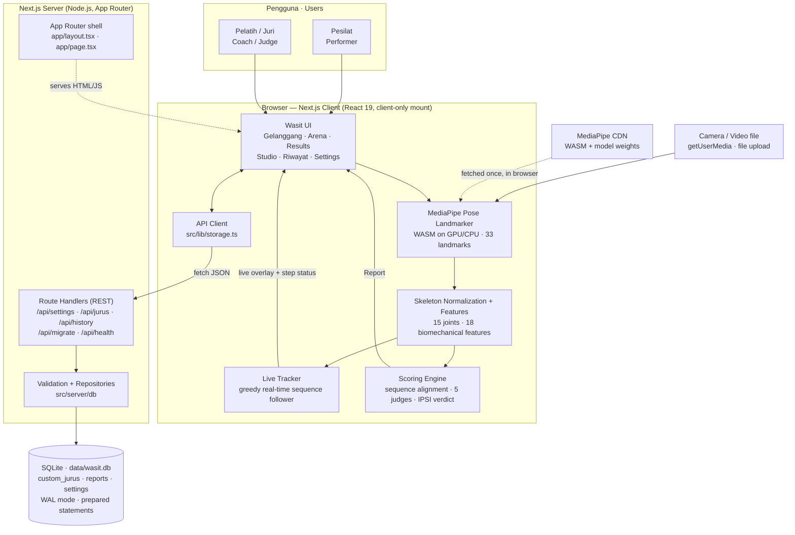
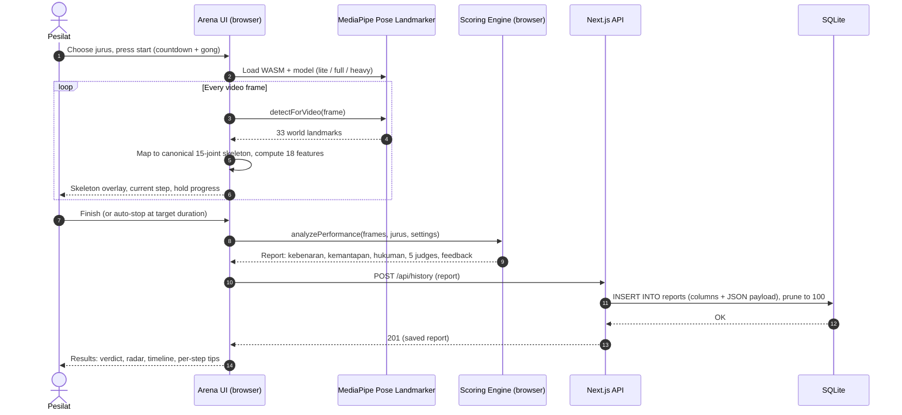
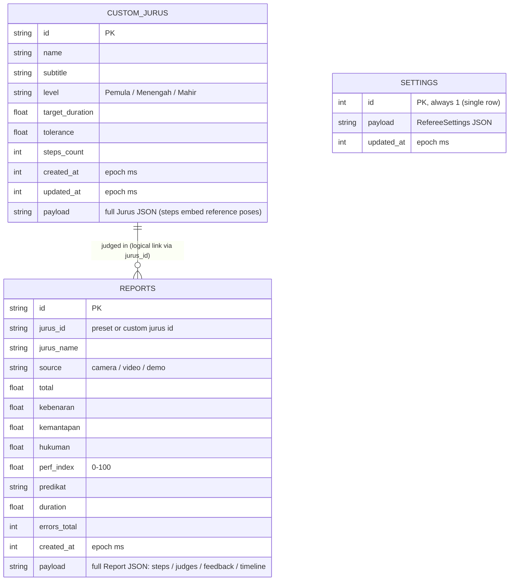

# Wasit Virtual Pencak Silat — AI Referee


**Wasit Virtual Pencak Silat** is an AI referee (*wasit*) for **Seni Tunggal**: perform a Pencak Silat *jurus* in front of your webcam — or upload a video — and receive an IPSI-style verdict covering sequence correctness, artistry and timing, with per-movement feedback in Bahasa Indonesia and English.

Pose estimation (MediaPipe Pose Landmarker) and scoring run **entirely in the browser** — video never leaves the device. Custom jurus, referee settings and the verdict history persist **server-side in SQLite**, served by Next.js Route Handlers.

> A training aid, not an official competition result.

## Features

- **Gelanggang (Home)** — 5 preset jurus from *Pemula* to *Mahir*, including a full 3-minute IPSI-timing simulation (180 s ± 5 s), plus your own custom jurus.
- **Arena** — judge a performance via **live camera**, **uploaded video**, or a **simulated demo** (Pendekar / Pesilat / Pemula). Real-time skeleton overlay, live step tracking (matched / missed / hold progress), countdown and gong.
- **Results (Verdict)** — IPSI score breakdown from a panel of 5 virtual judges, a 0–100 performance index with *predikat*, radar & timeline charts, per-step comparison against the reference pose, and coaching tips (*Kebenaran, Kemantapan, Irama, Waktu, Penghayatan, Tenaga, Stamina, Kamera*). Exportable as JSON.
- **Studio** — build custom jurus from the 22 reference poses (sikap, kuda-kuda, pukulan, tangkisan, tendangan, elakan) or **record a master's demonstration** and capture its key poses.
- **Riwayat (History)** — every saved verdict (up to 100), reopenable in full detail.
- **Settings** — strictness, mirror tolerance, match threshold, component weights, sound, pose-model size (Lite ≈ 5 MB / Full ≈ 9 MB / Heavy ≈ 29 MB) and auto-stop.

## High-Level Architecture



**Key design decisions**

| Decision | Rationale |
| --- | --- |
| Pose estimation & scoring in the browser | Privacy (video never uploaded) and zero server-side inference cost; WASM + model weights are fetched from CDN on first use. |
| Whole UI mounted client-only (`ssr: false`) | The app is camera/canvas/Web-Audio first; server-rendering it adds hydration risk for no benefit. Next.js still provides routing shell, metadata, bundling and the API. |
| SQLite via `better-sqlite3` (server-only) | Single-file, zero-admin persistence that survives restarts; synchronous prepared statements keep Route Handlers simple. The driver is kept out of the client bundle with `serverExternalPackages` + `server-only`. |
| Columns + JSON `payload` | Searchable/sortable fields are real columns; the full domain object (a jurus embeds reference poses, a report embeds skeletons/judges/timelines) is stored losslessly as JSON. |
| View-switcher instead of page routes | Preserves the original single-screen referee flow (Gelanggang → Arena → Results) and its state handling exactly. |

## How a Performance Is Judged



### Scoring model (IPSI Seni Tunggal structure)

| Component | How it is computed |
| --- | --- |
| **Nilai Kebenaran** (correctness) | 100 − number of movement errors. Each recorded frame is converted to 18 rotation-invariant features (joint angles, stance, lean, wrist height…) and compared with the jurus's reference poses; a full-sequence alignment decides which steps were hit, missed or mirrored. |
| **Nilai Kemantapan** (artistry, 50–60) | Blends stability, balance, power, rhythm (*irama*), expression (*penghayatan*), stamina and flow measured over the whole performance. |
| **Hukuman** (time penalty) | Deviation of the actual duration from the target beyond the jurus tolerance, banded IPSI-style. |
| **5 virtual judges** | Each judge profile (strict technique, balanced, firmness, rhythm, expression) scores independently; the highest and lowest totals are dropped and the **mean of the middle 3** becomes the official verdict. |
| **Performance index (0–100)** | Weighted blend (default Correctness 50 % · Artistry 30 % · Timing 20 %, adjustable in Settings) mapped to a *predikat*. |

Reference data ships in code: **22 reference poses** (11 authored poses + mirrored variants, built with forward kinematics) and **5 preset jurus** (*Jurus Dasar I/II, Latihan Kuda-kuda, Rangkaian Seni Tunggal, Simulasi Tunggal 3 Menit*).

## Persistence — SQLite

All mutable data lives in one SQLite file (default `data/wasit.db`, WAL mode, created automatically on first run):



Notes:

- `reports.jurus_id` is a *logical* link (no foreign key): verdicts can belong to preset jurus, which live in code, and a verdict must stay readable even after its custom jurus is deleted.
- History keeps the newest **100** verdicts (the old localStorage version capped at 25 due to browser quotas). Demo performances are never saved.
- **Upgrading from the old Vite version?** On first load the app detects the legacy `localStorage` keys (`wasit-silat:*:v1`) and imports them into SQLite via `POST /api/migrate`. The import is idempotent (existing ids are never overwritten) and non-destructive (the old keys are left in place as a backup).
- Reset everything with `npm run db:reset` (stop the server first).

## Tech Stack

| Layer | Technology |
| --- | --- |
| Framework | Next.js 15.5 (App Router) · React 19 · TypeScript (strict) |
| Styling | Tailwind CSS v4 (PostCSS) · Lucide icons |
| Pose estimation | MediaPipe Pose Landmarker (`@mediapipe/tasks-vision`, WASM + model from CDN, GPU with CPU fallback) |
| Persistence | SQLite via `better-sqlite3` (prepared statements, WAL) behind Next.js Route Handlers |
| Tooling | ESLint (eslint-config-next) · `tsc --noEmit` |

## Getting Started

**Prerequisites:** Node.js **22+** (required by `better-sqlite3` v13), npm, and a modern browser with camera access. A GPU is recommended for the *Heavy* pose model.

```bash
# 1. Install dependencies
npm install

# 2. Run the dev server (http://localhost:3000)
npm run dev

# — or run a production build —
npm run build
npm run start
```

The SQLite database is created automatically at `data/wasit.db` on first use. To place it elsewhere (e.g. a Docker volume), copy `.env.example` to `.env.local` and set `DATABASE_PATH`:

```bash
DATABASE_PATH=/var/lib/wasit/wasit.db npm run start
```

Camera access requires a secure context: `localhost` works out of the box; remote hosts need HTTPS.

## Scripts

| Command | Purpose |
| --- | --- |
| `npm run dev` | Next.js dev server with HMR |
| `npm run build` | Production build (typecheck + lint included) |
| `npm run start` | Serve the production build |
| `npm run typecheck` | `tsc --noEmit` |
| `npm run lint` | ESLint (Next core-web-vitals + TypeScript) |
| `npm run db:reset` | Delete the SQLite database (fresh start on next launch) |
| `node scripts/smoke-test.mjs` | End-to-end API smoke test against a running server (`BASE_URL` to override) |

## Project Structure

```text
.
├── public/hero.jpg                 # landing hero image
├── data/                           # SQLite database (wasit.db, gitignored, auto-created)
├── scripts/
│   ├── reset-db.mjs                # npm run db:reset
│   └── smoke-test.mjs              # API end-to-end smoke test
└── src/
    ├── app/                        # Next.js App Router
    │   ├── layout.tsx              # metadata, fonts, MediaPipe CDN preconnects
    │   ├── page.tsx                # mounts the client app
    │   ├── globals.css             # Tailwind v4 theme (gold / maroon / ink, batik motif)
    │   ├── icon.svg
    │   └── api/                    # Route Handlers (Node.js runtime, force-dynamic)
    │       ├── health/             # GET  liveness + DB counts
    │       ├── settings/           # GET · PUT
    │       ├── jurus/              # GET · POST        and [id]/ GET · PUT · DELETE
    │       ├── history/            # GET · POST · DELETE and [id]/ GET · DELETE
    │       └── migrate/            # POST one-time localStorage import
    ├── server/                     # server-only code (never bundled for the browser)
    │   ├── http.ts                 # JSON/error helpers for Route Handlers
    │   └── db/
    │       ├── schema.ts           # DDL for custom_jurus / reports / settings
    │       ├── client.ts           # better-sqlite3 singleton (DATABASE_PATH, WAL)
    │       ├── validate.ts         # runtime payload validation
    │       └── repositories.ts     # typed CRUD + legacy import + health check
    ├── components/
    │   ├── WasitApp.tsx            # root: view state, SQLite hydration, optimistic saves
    │   ├── ClientRoot.tsx          # dynamic(ssr: false) boundary + loading splash
    │   ├── SettingsDialog.tsx · StickFigure.tsx · charts.tsx · ui.tsx
    ├── views/                      # Home (Gelanggang) · Arena · Results · Studio · History (Riwayat)
    ├── hooks/usePoseEngine.ts      # camera/video loop, landmark smoothing, canvas overlay
    ├── lib/
    │   ├── storage.ts              # browser API client + bootstrap/migration + JSON export
    │   ├── pose/                   # detector · landmarks · features · similarity · fk (forward kinematics)
    │   ├── scoring/                # engine (IPSI verdict) · liveTracker · simulate (demo)
    │   ├── audio.ts                # synthesised gong / beeps
    │   └── math.ts
    ├── data/                       # poses.ts (22 reference poses) · jurus.ts (5 presets)
    └── types.ts                    # domain types shared by client and server
```

## API Reference

All endpoints return JSON; failures return `{ "error": "…" }` with a 4xx/5xx status. Bodies may wrap the entity (`{ "jurus": … }`) or send it directly.

| Method | Path | Description |
| --- | --- | --- |
| `GET` | `/api/health` | Liveness + database name and row counts |
| `GET` | `/api/settings` | `{ settings, persisted, updatedAt }` — defaults until first saved |
| `PUT` | `/api/settings` | Replace referee settings → `{ settings }` |
| `GET` | `/api/jurus` | List custom jurus → `{ jurus: Jurus[] }` (presets ship in code) |
| `POST` | `/api/jurus` | Create custom jurus (upsert by `id`) → `201 { jurus }` |
| `GET` | `/api/jurus/:id` | One custom jurus (404 if missing) |
| `PUT` | `/api/jurus/:id` | Create/update; the URL id wins → `{ jurus }` |
| `DELETE` | `/api/jurus/:id` | Delete → `{ ok: true }` |
| `GET` | `/api/history?limit=50` | Verdicts, newest first (max 100) → `{ reports: Report[] }` |
| `POST` | `/api/history` | Save a verdict → `201 { report }` (oldest pruned beyond 100) |
| `GET` | `/api/history/:id` | One full report |
| `DELETE` | `/api/history/:id` | Delete one verdict |
| `DELETE` | `/api/history` | Clear all verdicts → `{ ok: true, deleted: n }` |
| `POST` | `/api/migrate` | One-time legacy import `{ settings?, jurus?, reports? }` → `{ imported: { settings, jurus, reports } }` (idempotent) |

Example:

```bash
curl http://localhost:3000/api/health
curl http://localhost:3000/api/settings
curl -X PUT http://localhost:3000/api/settings \
  -H 'Content-Type: application/json' \
  -d '{"settings":{"strictness":1.25,"allowMirror":true,"matchThreshold":0.68,"weights":{"correctness":50,"artistry":30,"timing":20},"sound":true,"model":"full","autoStop":true}}'
```

## Privacy & Deployment

- **Video & pose inference never leave the browser.** Only settings, custom jurus definitions and finished verdicts (scores, skeletons of matched poses, charts data) are sent to the API and stored in SQLite.
- There is **no authentication and a single shared dataset** (one settings row, one history) — the app is designed for a dojo / personal training setup, not multi-tenant hosting. Put it behind your own auth/reverse proxy before exposing it publicly.
- SQLite needs a **persistent local disk**: run on a VM, a container with a volume (`DATABASE_PATH` → mounted path), or locally. Ephemeral/serverless filesystems will lose the database between deployments.
- `better-sqlite3` is a native addon: keep `serverExternalPackages: ['better-sqlite3']` (already in `next.config.ts`) and build/run on the same platform & Node 22+.

## What Changed in This Migration (Vite → Next.js, localStorage → SQLite)

| Before (Vite SPA) | After (Next.js) |
| --- | --- |
| `vite.config.ts` + `@vitejs/plugin-react` + `vite-plugin-singlefile` | `next.config.ts` + `postcss.config.mjs` (Tailwind v4 via `@tailwindcss/postcss`) |
| `index.html` (title, meta, font/CDN links) | `src/app/layout.tsx` (`metadata` / `viewport` exports + runtime font links) |
| `src/main.tsx` → `src/App.tsx` | `src/app/page.tsx` → `ClientRoot` (`dynamic(..., { ssr: false })`) → `src/components/WasitApp.tsx` |
| `src/index.css` | `src/app/globals.css` (unchanged theme) |
| `src/assets/hero.jpg` (Vite import) | `public/hero.jpg` (`/hero.jpg`) |
| `src/lib/storage.ts` — synchronous `localStorage` | Same module, now an **async REST client**; data lives in **SQLite** via `/api/*` Route Handlers and `src/server/db` repositories |
| History capped at 25 (localStorage quota) | History capped at **100**, pruned in SQL |
| — | One-time **automatic import** of legacy localStorage data into SQLite (idempotent, non-destructive) |
| `npm run build` = `vite build` (no typecheck) | `npm run build` = `next build` (compile + ESLint + TypeScript strict, incl. `noUnusedLocals`) |

## Troubleshooting

- **Camera does not start** — allow camera permission; use `localhost` or HTTPS; check no other app holds the webcam.
- **Pose model slow / fails to load** — the WASM runtime and model weights load from `cdn.jsdelivr.net` / `storage.googleapis.com` on first use (internet required once); the engine falls back from GPU to CPU automatically. Try the *Lite* model in Settings on low-end devices.
- **"Could not load saved data" banner** — the API/DB is unreachable; the referee still works with defaults. Check `GET /api/health`, the server logs, and that `DATABASE_PATH`'s directory is writable.
- **Start completely fresh** — stop the server, run `npm run db:reset`, start again.

---

*Salam Silat!* Wasit Virtual is a training aid for pesilat, coaches and jurus enthusiasts — not an official IPSI competition result.
